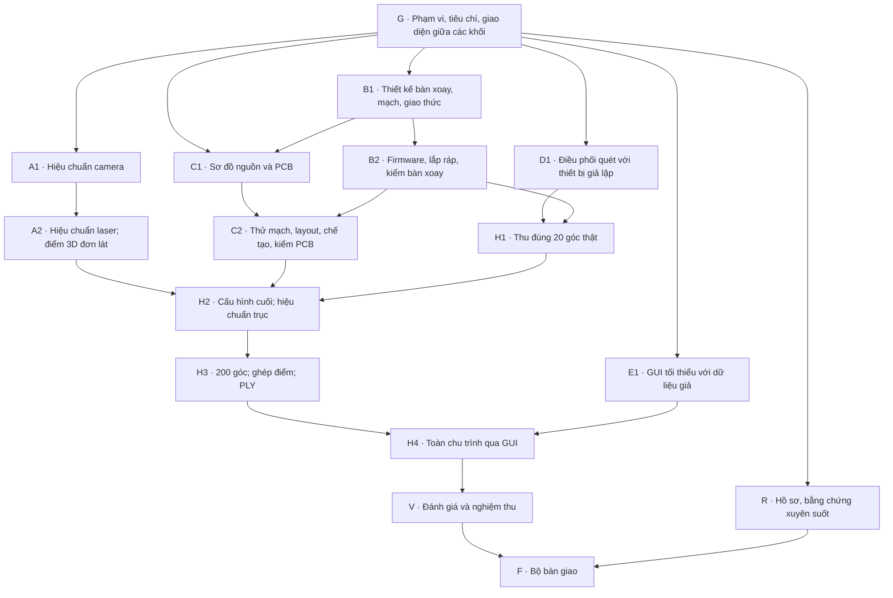

# Roadmap theo nhánh phụ thuộc và điểm hội tụ

**NGƯỜI DÙNG CHỐT 2026-10-08 — D048.** Thay cách chia tuần 3–14 bằng
khối công việc có đầu vào, đầu ra và cổng kiểm chứng. Giữ nguyên nội dung,
tiêu chí, trình tự và bàn giao tuần 2 đang thực hiện. Trạng thái thực tế:
[STATUS](../STATUS.md). Có tên trong sơ đồ không có nghĩa đã triển khai/đạt.

## 1. Phạm vi và mốc đích

- Giữ STM32 Nucleo-F446RE điều khiển, ESP32-S3/OV3660 thu ảnh, PC điều phối
  và xử lý; một camera, một laser vạch, một trục quay; vật đục, nhám 50–100 mm.
- Một cấu hình camera chính kế thừa tuần 2; **200 góc/vòng, 400 ảnh OFF/ON
  được chọn hợp lệ**, giữ riêng mọi payload thử lại.
- Hiệu chuẩn đủ camera, laser và trục; xuất **PLY đơn vị mm**, giữ ảnh thô,
  cấu hình, hiệu chuẩn và phiên bản mã để xử lý lại.
- GUI tối thiểu: kết nối, kiểm sẵn sàng, chọn hồ sơ hợp lệ, bắt đầu/dừng,
  tiến độ/lỗi, ảnh theo dõi, mở phiên, xử lý lại, xuất PLY. Xem 3D bằng
  công cụ độc lập.
- Giữ PCB mở rộng tự thiết kế chạy tải thật, nguồn, HOME và hộp che.
  Yêu cầu an toàn/liên động SPEC §9 đã bỏ theo D050 (09/10/2026).
- Chuyển dựng lưới/OBJ/STL, in 3D, trình xem/chỉnh sửa 3D tích hợp, so sánh
  COG/Gauss, 200/400 góc, nhiều độ phân giải/JPEG sau tuần 2, xử lý tại thiết
  bị và quét nhiều tư thế sang tốt nghiệp. Không xoá mã/kết quả đã có;
  khảo sát C2b và mọi phép kiểm tuần 2 vẫn nguyên vẹn.

| Mốc mục tiêu | Kết quả |
| --- | --- |
| 01–03/12/2026 | H4: toàn chu trình qua GUI trên thiết bị có PCB đã kiểm |
| Trước 24/12/2026 | V: đánh giá, sửa lỗi, nghiệm thu cấu hình cuối |
| Trước 31/12/2026 | F: bộ bàn giao; hạn nộp người dùng báo đầu tháng 01/2027, chưa có ngày cụ thể |

Người dùng xác nhận **4 giờ/ngày, mọi ngày** = 28 giờ/7 ngày. Dự kiến
20–22 giờ việc chính, 6–8 giờ dự phòng/kiểm lại; không phải giờ đã làm.
Không áp lịch tuần n = 16/09 + 7×(n−1) cho phần sau tuần 2. D010 vẫn là
lịch sử tuần 1. Mốc đích không thay cổng kỹ thuật.

## 2. Sơ đồ tổng thể

Mũi tên là phụ thuộc; nhiều mũi tên vào một khối nghĩa là cần **tất cả**
đầu vào. Sản phẩm tuần 2 cần cho từng khối ghi ở mục 3; không gom thành
cổng chặn mọi việc. Chưa qua cổng chỉ làm phần độc lập/giả lập.

## 3. Hợp đồng các nhánh

### G — Điểm gốc [Q1–Q4]

Chốt phạm vi/tiêu chí theo SPEC, giao thức chuyển động/dừng, cấu trúc
phiên quét, giao diện điều phối–hình học–GUI, đơn vị/hệ tọa độ và lỗi.
Thiết kế chi tiết chưa có phải lập và qua cổng trước khi viết mã; roadmap
không thay đặc tả API hoặc 01_PLAN.md. Mạch điện đi Q5 trước lắp thử.

### A — Hiệu chuẩn và hình học [Q3, Q4, Q6, Q8, Q9]

| Khối | Đầu vào | Đầu ra và kiểm chứng |
| --- | --- | --- |
| A1 | G; camera/cấu hình đã xác nhận từ C2/C2b tuần 2; gá ổn định, ô bàn cờ đo thực | ≥20 ảnh khớp + ≥5 kiểm tra độc lập; nội tham số/méo, sai số từng ảnh; lưu/nạp lại; cùng dữ liệu/cấu hình cho cùng kết quả; chặn hồ sơ thiếu/sai độ phân giải |
| A2 | A1; C3 và C5/C7 tuần 2 qua cổng; C6 đủ điều kiện laser; camera–laser cố định | ≥6 tư thế khớp + ≥2 kiểm tra; mặt phẳng laser; điểm hữu hạn, trước camera, mm; PLY đơn lát mở được, xử lý lại ngoại tuyến |

Mục tiêu A1: RMS ≤0,7 px bộ khớp, ≤1,0 px bộ kiểm tra. A2: RMS khoảng
cách đến mặt phẳng bảng ở từng tư thế kiểm tra ≤2 mm. A1 không cần bàn
xoay/PCB; A2 không cần bàn xoay tự động. C7 chưa đạt xử lý theo D016 và
kế hoạch tuần 2, không dùng roadmap mới để bỏ cổng.

### B — Bàn xoay và chuyển động [Q3, Q5, Q6, Q8, Q9]

| Khối | Đầu vào | Đầu ra và kiểm chứng |
| --- | --- | --- |
| B1 | G; giao thức C4 đã chốt; thông tin linh kiện thực đủ đối chiếu | Thiết kế truyền động, tải, HOME/gá; sơ đồ driver/nguồn; giới hạn HOME, chuyển động, chờ ổn định, xử lý lỗi |
| B2 | B1 qua cổng; linh kiện kiểm nhận; sơ đồ trước lắp; mạch/nguồn đủ điều kiện | Firmware, cơ cấu; HOME 10/10; không thấy HOME phải dừng; đo độc lập 24/48 xung; 10 vòng có tải; ảnh ở bốn mức chờ 100/200/400/800 ms để chọn mức cố định |

Mục tiêu lệch dấu chuẩn ≤1 mm tại R=70 mm. Góc theo xung là góc điều
khiển ước tính. Firmware/giả lập làm được khi chờ linh kiện; gá quang học
cố định cần kết quả A và tuần 2.
Gói đổi roadmap không sửa hồ sơ phần cứng; các thông số vật lý triển khai
theo hồ sơ phần cứng đã được duyệt và kiểm chứng.

### C — Nguồn và PCB [Q5 → Q7 → Q8 → Q9]

C1 cần G/B1 thống nhất chân, tải, đầu nối; làm cùng firmware B2. C2 cần
mạch laser C6 và chuyển động B2 đã thử thực. Chuỗi:
schematic → thử mạch/tải → chốt chân/linh kiện → layout → ERC/DRC →
chế tạo → kiểm nguồn → gắn tải → kiểm toàn bo. Chỉ đặt bo sau kiểm mạch.

Đầu ra: schematic, layout hai lớp, Gerber, drill, BOM, bản vẽ kết nối,
biên bản; ERC/DRC không còn lỗi chưa xử lý/giải trình. Mục tiêu nguồn
camera 4,75–5,25 V với tải; PCB chạy tải thật. Không chờ mô hình 3D hoàn chỉnh để đặt PCB. Thời gian nhận
bo chưa bảo đảm; thiếu PCB vẫn là việc chưa đạt.

### D — Điều phối quét [Q3, Q4, Q6, Q9 giả lập → Q8/Q9 thật]

D1 cần G và hợp đồng giao tiếp/dữ liệu đã chốt. Kế thừa tuần 2, không sửa
C2–C7 để làm trước; viết phần độc lập bằng giả lập, gắn thu cặp thật sau
khi sản phẩm tương ứng qua cổng.

Chu trình: kiểm sẵn sàng → HOME → đến góc → chờ ổn định → OFF → ON →
tắt laser → kiểm/lưu cặp → chuyển góc. Thử mất liên lạc, phản hồi chậm/
sai/lặp, ảnh lỗi/cũ/sai cấu hình, dừng giữa chu trình. Tối đa hai lần
retry sau lần đầu, giữ cùng góc; hết hạn/lượt thử dừng và bảo toàn dữ liệu.
Không chuyển mâm trước khi lưu cặp hợp lệ.

### E — GUI tối thiểu [Q3, Q4, Q6, Q9]

E1 cần giao diện lập trình D đã chốt ở G; dựng với dữ liệu giả cùng D1.
Chức năng đúng mục 1; GUI gọi bộ điều phối chung, không nhân bản logic
điều khiển. Xem PLY bằng công cụ độc lập, không có chỉnh sửa 3D tích hợp.

## 4. Các điểm hội tụ

| Khối | Đủ các đầu vào | Cổng kiểm chứng |
| --- | --- | --- |
| H1 [Q8–Q9] | B2 + D1 + camera/laser/thu cặp tuần 2 đạt | 20 góc → 40 ảnh hợp lệ; đúng ảnh–góc–trạng thái/cấu hình; lặp 10 lệnh không thêm chuyển động; retry/dừng đúng; log đủ. Chưa cần hiệu chuẩn trục |
| H2 [Q8, hiệu chuẩn, Q9] | A2 + H1 + C2 + gá/mâm/hộp cố định | Kiểm hiệu lực camera/laser; đổi hình học thì hiệu chuẩn lại phần liên quan; trục ≥10 góc khớp + ≥3 kiểm tra; chiều quay xác nhận; RMS ≤2 mm (MT), không ICP che lỗi; bộ hiệu chuẩn cùng cấu hình |
| H3 [Q6–Q9] | H2, kế thừa bộ điều phối H1 | 200 vị trí 0–358,2°, không chụp thêm 360°; 400 ảnh được chọn, retry riêng; ghép hệ mm; lọc cơ bản ghi tham số/số điểm trước–sau; PLY mở độc lập; xử lý lại không nối thiết bị |
| H4 [Q6–Q9] | H3 + E1 | Đặt vật → HOME → quét → lưu → xử lý → xuất PLY qua GUI; 6 luồng chức năng, 4 ca đầu vào sai; mở ≥2 phiên ngoại tuyến; GUI phản hồi trong 1 s khi tác vụ dài (MT); PCB đã kiểm tải thật |

Biến đổi tọa độ/ghép điểm thử bằng dữ liệu tổng hợp được trước H2;
nghiệm thu thật vẫn chờ H2. Bộ xuất PLY làm từ A2; E1 nối D giả được
trước H3. Đổi cấu hình phải kiểm lại phần liên quan, không mặc định bằng
chứng cũ áp dụng.

## 5. V — Đánh giá, sửa lỗi và nghiệm thu [Q9]

| Nhóm | Bắt buộc (B) / mục tiêu chất lượng (MT) |
| --- | --- |
| Đối chứng | ≥3 mẫu nhám đơn giản, ít nhất một kích thước đối chứng độc lập phù hợp/mẫu; không dùng kích thước kiểm tra để chỉnh thang đo rồi báo trên chính nó (B) |
| Sai số | Mỗi kích thước 50–100 mm: sai số tuyệt đối ≤2 mm (MT); báo từng trị và điều kiện kể cả chưa đạt |
| Lặp lại | Một mẫu 5 phiên cùng điều kiện; từng trị, trung bình, độ lệch chuẩn mẫu, min–max; tháo đặt lại nếu có báo riêng (B) |
| Ổn định | 3 lượt 200 góc liên tiếp, mỗi lượt 400 ảnh; không reset/thiếu góc âm thầm (B) |
| Thời gian | ≤15 phút/lượt **200 góc**, từ bắt đầu HOME đến lưu ảnh cuối, kể cả retry (MT mới được duyệt); đo xử lý/GUI riêng, không lấy thời gian 400 góc chia đôi |
| Chụp lại | Yêu cầu gốc cần ≥1 retry / tổng yêu cầu gốc ≤2% (MT) |
| Tái tạo | Môi trường PC mới xử lý lại phiên mẫu theo README; ảnh gốc, cấu hình, hiệu chuẩn, commit truy xuất được (B) |

Lỗi quay nhánh gây lỗi, kiểm lại phần ảnh hưởng và tích hợp cần thiết:
hình học → A/B; sai ảnh–góc → D/H1; reset do tải → B/C; GUI → E/H4.
Không hạ ngưỡng sau đo để ghi đạt. B chưa đạt chặn phần phụ thuộc; MT
chưa đạt báo số/nguyên nhân và chỉ tiếp tục phần độc lập; giữ cổng C7/D016.

## 6. R và F — Hồ sơ xuyên suốt, bàn giao

R ghi thiết kế, ảnh, số đo, bản thảo theo khối đã hoàn thành, chỉ dùng
bằng chứng thực tế. F cần V + R: thiết bị, hồ sơ phần cứng, firmware/build,
ứng dụng/môi trường, ảnh/hiệu chuẩn/PLY/log, báo cáo/slide/video. Diễn tập
đầy đủ, có dữ liệu ngoại tuyến; kết luận có nguồn. Chưa đo không ghi đạt.

## 7. Nhánh Git và làm song song

| Luồng | Chuỗi nhánh dự kiến — chưa tạo |
| --- | --- |
| A | `feat/cal-camera` → `feat/cal-laser` → `feat/cal-axis` → `feat/pointcloud-ply` |
| B | `feat/turntable-control` |
| C | `feat/pcb-extension` → `feat/pcb-bringup` |
| D | `feat/scan-controller` → `feat/scan-integration` |
| E | `feat/gui-minimal` |

Mỗi gói đi Planner → Coder → Tester → Reviewer; gộp sau phán quyết GỘP
và chỉ định người dùng. Gói sau kế thừa mốc đã gộp; chỉ mở nhánh khi làm.
Mỗi phiên viết song song một worktree, không sửa cùng tệp mã; giao thức/
schema/thư viện chung cập nhật tuần tự. Một thời điểm chỉ một phép thử
điều khiển bộ bo/camera/gá. Ưu tiên một việc thiết bị + một việc PC độc lập.
Ngoại lệ đồng bộ tài liệu D048 không áp dụng gói triển khai tương lai.

## 8. Đọc các nhãn lịch cũ trong hồ sơ giữ nguyên

| Nhãn lịch sử | Khối hiện hành |
| --- | --- |
| Tuần 1–2 | Giữ nội dung/bằng chứng và mọi handoff đang làm |
| Tuần 3 / 4 | A1 / A2 |
| Tuần 5 / 6 | B1–B2 / C1–C2 |
| Tuần 7 / 8 | H1 / H2 |
| Tuần 9 / 10 | H3 / E1–H4 |
| Tuần 11 / 13 | V |
| Tuần 12 | Lưới chuyển tốt nghiệp; quỹ dành sửa lỗi/kiểm lại |
| Tuần 14 | R xuyên suốt, F kết thúc |

Nhãn tuần trong hồ sơ phần cứng, mã, log, báo cáo tiến độ có ngày và
handoff cũ là tham chiếu lịch sử; không sửa các tệp đó chỉ để đổi nhãn.
Giữ mốc tuần 1 bắt đầu 16/09/2026, không suy tiến độ từ tuần lịch.
Hai Word nguồn đồng bộ kế hoạch mới; BOM cũ không thành cấu hình hiện
hành. Yêu cầu chi tiết và quy cách đo: [SPEC](SPEC.md).
