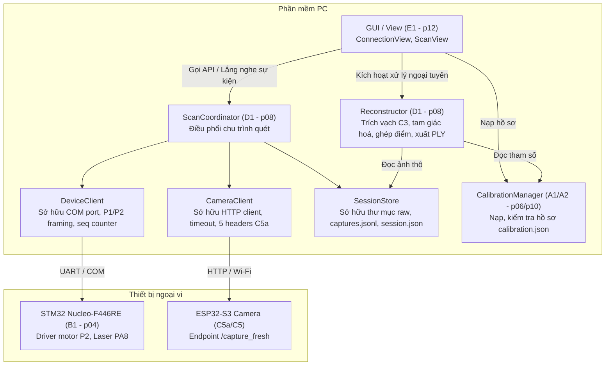

# Giao diện giữa các khối, API và hệ toạ độ (Khối G) — bước Q3/Q4

Ngày lập: 2026-10-09 (p02 G).
Trạng thái: **Hợp đồng thiết kế đích (phiên bản 1.0) cho toàn bộ hệ thống scanner3d.**
Căn cứ:
- `docs/PROCESS.md` R2, R4; `docs/ROADMAP.md` Khối G (gốc của B, C, D, E và hệ toạ độ cho A);
- `docs/SPEC.md` §4.3, §5.1–5.4, §6–8, §13–15;
- `docs/design/NUCLEO_PROTOCOL.md` (hợp đồng giao thức P1/P2);
- `docs/design/SCAN_SESSION.md` (cấu trúc dữ liệu phiên quét và hồ sơ hiệu chuẩn);
- Quyết định người dùng 2026-10-09 (p02 G): P2/96 byte, cache motor riêng, chân/giới hạn vật lý giao p04, T_settle 400 ms tạm đo ở B2, gỡ an toàn SPEC §9 theo D050.

> [!NOTE]
> Đây là **hồ sơ hợp đồng giao diện thiết kế**, phân định ranh giới và kiểu dữ liệu giữa các khối trước khi tách nhánh triển khai. Các phương thức và lớp trong tài liệu này là **thiết kế đích**, không suy diễn là đã có mã thực thi trong `pc/`.

---

## 1. Ranh giới và quyền sở hữu tài nguyên

Hệ thống scanner3d được chia trách nhiệm rõ ràng theo các chủ sở hữu (owners):



### 1.1 Quyền sở hữu tài nguyên
1. **`DeviceClient`**:
   - Sở hữu độc quyền kết nối Serial/COM tới Nucleo-F446RE.
   - Quản lý bộ đếm `seq` tăng dần đơn điệu (1..65535, không quay vòng trong phiên).
   - Đóng gói khung bản tin P1/P2 và tính toán/kiểm tra checksum XOR `*<hh>`.
   - Kiểm tra định danh firmware: đọc banner khởi động `BOOT NucleoScan ... P2`. Nếu kết nối sau khi bo đã boot (không đọc được banner `BOOT`), PC gửi `ID?` (hoặc `1 ID?*23`) và kiểm tra token thứ 6/7 là `PROTOCOL_P2`. Bo kiểm tra seq và checksum hợp lệ trước khi phân tích token `PROTOCOL_P2`. Nếu token này vắng mặt, xác định firmware là P1 và chặn các lệnh chuyển động motor (`FIRMWARE_P1_MOTOR_UNSUPPORTED`).
   - Xử lý retry giao tiếp cấp thấp (timeout, mất kết nối, khung lỗi).
2. **`CameraClient`**:
   - Sở hữu kết nối HTTP tới ESP32-S3 (`/capture_fresh`, `/status`, `/control`).
   - Quản lý timeout kết nối (socket timeout 5 s, deadline tổng 10 s).
   - Kiểm tra đầy đủ 5 headers chẩn đoán bắt buộc: `X-Frame-Id`, `X-Boot-Id`, `X-Timestamp`, `X-Request-Timestamp`, `X-Discarded-Frames`.
   - Kiểm tra tính toàn vẹn JPEG (magic bytes `FF D8` SOI, `FF D9` EOI, giải mã thử nghiệm, kiểm tra kích thước ảnh đúng `camera_config`).
   - Phát hiện reboot cảm biến qua `X-Boot-Id`.
3. **`SessionStore`**:
   - Sở hữu độc quyền thư mục phiên quét tại `data/raw/<scan_id>/`.
   - Tạo thư mục an toàn, từ chối chạy nếu thư mục đã tồn tại.
   - Quản lý tệp nhật ký append-only `captures.jsonl` (ghi flush ngay từng dòng sau mỗi sự kiện).
   - Lưu trữ bất biến các ảnh chụp được chọn `img_<step:04d>_<off|on>.jpg` và toàn bộ payload lỗi `img_<step:04d>_<off|on>_try<k>.jpg|.bin`.
   - Cập nhật `session.json` ở đầu phiên và chốt trạng thái ở cuối phiên.
4. **`ScanCoordinator`**:
   - Điều phối toàn bộ luồng công việc quét 200 góc / 400 ảnh.
   - Tương tác với GUI qua kiến trúc hướng sự kiện / trạng thái snapshot; chạy tác vụ quét trong worker thread riêng biệt, không chặn giao diện.
   - Tiếp nhận yêu cầu dừng khẩn (`request_stop`) và xác nhận dừng tại ranh giới lưu dữ liệu an toàn.
5. **`CalibrationManager`**:
   - Nạp và xác thực hồ sơ hiệu chuẩn `calibration.json` từ `data/calibration/<id>/`.
   - So khớp kích thước và profile với phiên quét trước khi cho phép tái tạo.
6. **`Reconstructor`**:
   - Thực hiện quy trình xử lý ảnh ngoại tuyến: gọi trích tâm vạch C3 (`centers/`), tam giác hoá tia–mặt phẳng, biến đổi toạ độ theo trục quay mâm, ghép đám mây điểm 3D và xuất tệp `points.ply`.
   - Ghi lại provenance xử lý vào `data/processed/<scan_id>/<run_id>/processing.json`.

---

## 2. Hợp đồng API công khai giữa Điều phối, GUI và Hình học

### 2.1 Định nghĩa các cấu trúc dữ liệu cốt lõi

```python
from dataclasses import dataclass, field
from typing import Optional, List, Dict, Any

@dataclass
class ScanConfig:
    """Cấu hình khởi động một phiên quét từ GUI."""
    scan_id: Optional[str] = None          # None -> tự sinh theo định dạng scan_YYYYMMDD_HHMMSS
    preset_name: str = "TURNTABLE_200"     # Tên cấu hình quét
    total_angles: int = 200                # Số góc quét thiết kế (mặc định 200)
    step_increment: int = 48               # Số xung di chuyển giữa hai góc liên tiếp (9600 / 200)
    settle_ms: int = 400                   # Thời gian ổn định rung mâm T_settle sau khi dừng bước
    laser_max_ms: int = 5000               # Giới hạn bật laser an toàn T_laser_max của firmware
    laser_settle_ms: int = 50              # Chờ quang học laser ổn định trước khi chụp
    exposure_mode: str = "fixed"           # Chế độ phơi sáng ("fixed" theo profile C2)
    camera_profile_id: str = "cam_SVGA_q20_20260928" # Profile camera bắt buộc
    calibration_id: str = "none"           # Thư mục hiệu chuẩn hình học liên kết (hoặc "none")
    auto_home: bool = True                 # Tự động chạy HOME nếu mâm chưa homed lúc bắt đầu
    output_dir: str = "data/raw"           # Thư mục gốc lưu trữ phiên quét

@dataclass
class SessionData:
    """Dữ liệu trạng thái và cấu hình đọc từ một phiên quét đã lưu."""
    session_id: str
    session_path: str
    status: str                            # "running" | "paused" | "aborted" | "completed" | "error"
    schema_version: int = 2
    total_angles: int = 200
    angles_completed: int = 0
    pairs_captured: int = 0
    raw_images_count: int = 0
    error_code: Optional[str] = None
    abort_reason: Optional[str] = None
    camera_config: Dict[str, Any] = field(default_factory=dict)
    motion_config: Dict[str, Any] = field(default_factory=dict)

@dataclass
class ReconstructionParams:
    """Tham số điều khiển quy trình tái tạo 3D ngoại tuyến."""
    run_id: Optional[str] = None           # None -> tự sinh theo định dạng run_YYYYMMDD_HHMMSS
    line_extract: Dict[str, Any] = field(default_factory=lambda: {
        "roi": [0, 0, 800, 600],
        "min_diff": 15,
        "max_width": 30,
        "sat_thresh": 250,
        "img_width": 800,                  # Đúng 6 trường bắt biến theo pc/line_extract.py:591
        "img_height": 600
    })
    triangulation: Dict[str, Any] = field(default_factory=lambda: {
        "min_z_mm": 50.0,
        "max_z_mm": 800.0,
        "ray_parallel_eps": 1e-4,
        "filter_outliers": True
    })
    ply_format: str = "binary_little_endian" # "ascii" hoặc "binary_little_endian"

@dataclass
class CalibrationProfile:
    """Dữ liệu hồ sơ hiệu chuẩn nạp từ calibration.json."""
    version: int = 1
    calibration_id: str = ""
    unit: str = "mm"
    camera_profile_id: str = ""
    camera_config: Dict[str, Any] = field(default_factory=dict) # framesize, quality, img_width, img_height
    camera: Dict[str, Any] = field(default_factory=dict)        # matrix_k, distortion [k1,k2,p1,p2,k3], distortion_model
    laser: Optional[Dict[str, Any]] = None                      # normal, d_mm, plane_equation
    turntable: Optional[Dict[str, Any]] = None                  # center_mm, axis_vector, rotation_sign
```

### 2.2 Lớp `ScanCoordinator` (Khối Điều phối D)

```python
@dataclass
class ReadyStatus:
    ready: bool                            # True khi đủ điều kiện quét; False khi thiếu thiết bị hoặc chưa homed (nếu auto_home=False)
    nucleo_ok: bool                        # Cổng COM mở thành công, phản hồi P2 hợp lệ
    nucleo_protocol: int                   # 1 (P1 legacy, không motor) hoặc 2 (P2 hỗ trợ motor)
    camera_ok: bool                        # ESP32-S3 phản hồi /capture_fresh hợp lệ
    camera_boot_id: str                    # Boot ID hiện tại của camera
    camera_config_matched: bool            # Cấu hình cảm biến khớp với profile đã chọn
    storage_ok: bool                       # Đĩa cứng có quyền ghi, không bị trùng thư mục
    homed: bool                            # Bàn xoay đã tìm thấy gốc và biết vị trí 0
    message: str                           # "READY" | "NEED_HOME" | "NOT_CONNECTED" | "PROTOCOL_MISMATCH"
    errors: list[str] = field(default_factory=list)

@dataclass
class ScanStatusSnapshot:
    scan_id: str
    state: str                             # "INIT" | "HOMING" | "READY" | "MOVING" | "SETTLING" | "CAPTURING" | "PROCESSING" | "PAUSED" | "ABORTED" | "COMPLETED" | "ERROR"
    homed: bool                            # Trạng thái vị trí bàn xoay (True = đã xác định gốc)
    step_index: int                        # Chỉ số góc hiện tại (0..199)
    step_target: int                       # Số xung đích (0..9552)
    angle_cmd_deg: float                   # Góc lệnh danh định (0.0..358.2)
    angles_done: int                       # Số góc đã hoàn tất thu và lưu hợp lệ vào đĩa (0..200)
    pairs_ok: int                          # Số cặp ảnh OFF/ON hợp lệ đã lưu (0..200)
    current_attempt: int                   # Lần thử chụp tại góc hiện tại (1..3)
    preview_image_path: Optional[str] = None # Đường dẫn ảnh xem trước gần nhất
    last_error_code: Optional[str] = None  # Mã lỗi gần nhất (hoặc None)
    last_error_msg: Optional[str] = None   # Thông báo lỗi chi tiết (hoặc None)

class ScanCoordinator:
    def check_ready(self, config: ScanConfig) -> ReadyStatus:
        """Kiểm tra điều kiện tiên quyết trước khi quét.
        - Thiết bị: Cổng Serial kết nối, nhận diện đúng P2; Camera phản hồi 5 headers hợp lệ.
        - Trạng thái HOME: Nếu mâm chưa HOME (homed == False):
          + Nếu config.auto_home == True: trả về ready = True, homed = False, message = "READY_AUTO_HOME".
          + Nếu config.auto_home == False: trả về ready = False, homed = False, message = "NEED_HOME".
        - Lưu trữ: Thư mục chưa tồn tại, đĩa ghi được.
        """
        ...

    def start_scan(self, config: ScanConfig) -> str:
        """Khởi động phiên quét trong worker thread độc lập.
        - Nếu mâm chưa HOME và config.auto_home == True: Chu trình quét tự động thực hiện lệnh HOME trước (trạng thái HOMING -> SETTLING -> READY), sau đó mới tiến hành quét từ góc 0.
        - Nếu mâm chưa HOME và config.auto_home == False: Ném lỗi NotHomedError.
        - Trả về scan_id duy nhất cho phiên quét.
        """
        ...

    def request_stop(self, action: str = "abort") -> None:
        """Yêu cầu dừng phiên quét từ GUI (action = "pause" | "abort").
        - Trả quyền điều khiển ngay lập tức cho GUI (mục tiêu kỹ thuật: non-blocking thread, đáp ứng chỉ tiêu tổng thể <= 1 s theo SPEC §4.3 / MT H4; mục tiêu thiết kế nội bộ < 100 ms).
        - Worker thread sẽ: ngắt xung timer, hạ laser về mức thấp, hoàn tất lưu sự kiện đang dở; nếu có lệnh motor đang pending (MOVING/SETTLING/HOMING), cập nhật motor_cache.terminal = "<last_motor_seq> ERROR MOTOR_STOPPED"; nếu lệnh motor đã hoàn tất trước đó thì giữ nguyên kết quả terminal đã có.
        - Chuyển trạng thái snapshot sang PAUSED (nếu action == "pause") hoặc ABORTED (nếu action == "abort").
        - Cập nhật session.json status = "paused" hoặc "aborted".
        """
        ...

    def get_status(self) -> ScanStatusSnapshot:
        """Lấy ảnh chụp trạng thái hiện tại một cách thread-safe cho GUI hiển thị (mục tiêu thiết kế nội bộ < 10 ms)."""
        ...

    def open_session(self, session_path: str) -> SessionData:
        """Đọc và kiểm tra tính toàn vẹn của một phiên quét đã lưu trên đĩa.
        - Hỗ trợ các trạng thái phiên: "running" | "paused" | "aborted" | "completed" | "error".
        - Đối với phiên "paused": Nạp đầy đủ counts, pairs_ok, angle_table. Vị trí motor lúc này không xác định (homed = False). Nếu tiếp tục phiên quét, hệ thống bắt buộc thực hiện HOME lại trước khi di chuyển tới góc kế tiếp (step_index = angles_done).
        """
        ...
```

**Ví dụ minh hoạ snapshot trạng thái:**
1. *Snapshot trước khi HOME (khởi tạo ban đầu):*
   ```python
   ScanStatusSnapshot(
       scan_id="",
       state="INIT",
       homed=False,
       step_index=0,
       step_target=0,
       angle_cmd_deg=0.0,
       angles_done=0,
       pairs_ok=0,
       current_attempt=1,
       preview_image_path=None,
       last_error_code=None,
       last_error_msg=None
   )
   ```
2. *Snapshot sau khi huỷ quét khẩn cấp (sau `request_stop("abort")` tại góc 42):*
   ```python
   ScanStatusSnapshot(
       scan_id="scan_20261009_140000",
       state="ABORTED",
       homed=False,
       step_index=42,
       step_target=2016,
       angle_cmd_deg=75.6,
       angles_done=42,
       pairs_ok=42,
       current_attempt=1,
       preview_image_path="data/raw/scan_20261009_140000/img_0042_off.jpg",
       last_error_code="STOP_REQUESTED",
       last_error_msg="Nguoi dung yeu cau dung phien"
   )
   ```

### 2.3 Lớp `CalibrationManager` (Khối Hiệu chuẩn A)

```python
class ValidationResult:
    valid: bool
    has_camera: bool
    has_laser: bool
    has_turntable: bool
    errors: list[str]

class CalibrationManager:
    @staticmethod
    def load(path: str) -> CalibrationProfile:
        """Nạp hồ sơ calibration.json từ đĩa.
        Lỗi: Ném CalibrationInvalidError nếu cú pháp JSON hỏng hoặc thiếu trường bắt buộc.
        """
        ...

    @staticmethod
    def validate(
        profile: CalibrationProfile,
        camera_config: dict,
        required_parts: list[str]  # e.g. ["camera", "laser", "turntable"]
    ) -> ValidationResult:
        """Kiểm tra tương thích giữa hồ sơ hiệu chuẩn và cấu hình cảm biến.
        Quy tắc đối chiếu camera_config:
          - framesize phải trùng khớp chính xác (ví dụ "SVGA").
          - Độ phân giải img_width và img_height phải khớp kích thước ảnh thực tế.
          - quality ghi log cảnh báo nếu lệch.
          - Lệch framesize hoặc kích thước phân giải -> valid = False, ghi lỗi vào errors.
        """
        ...
```

### 2.4 Lớp `Reconstructor` (Khối Hình học / Tái tạo 3D D)

```python
class ReconstructionResult:
    run_id: str
    output_dir: str
    ply_path: str
    total_points: int
    valid_points: int
    rms_residual_mm: float
    execution_time_s: float
    success: bool
    error_msg: str | None

class Reconstructor:
    def process(
        self,
        session_dir: str,
        calibration: CalibrationProfile,
        output_dir: str,
        params: ReconstructionParams
    ) -> ReconstructionResult:
        """Thực hiện tái tạo 3D ngoại tuyến cho một phiên quét.
        Tiền điều kiện:
          - session_dir chứa đủ ảnh thô và session.json hợp lệ.
          - calibration hợp lệ đủ 3 phần ["camera", "laser", "turntable"].
          - calibration.camera_config khớp với session.json.
        Hậu điều kiện:
          - Ghi kết quả vào output_dir/<run_id>/.
          - Thư mục con centers/ lưu params.json C3 (đúng 6 trường: roi, min_diff, max_width, sat_thresh, img_width, img_height) và centers_*.csv.
          - Tệp processing.json ghi lại provenance cấp run.
          - Tệp points.ply chứa mây điểm 3D trong hệ toạ độ camera gốc tại HOME.
        """
        ...
```

---

## 3. Bảng phân loại mã lỗi và xử lý ngoại lệ

Để bảo đảm tính rõ ràng và khả năng truy vết lỗi thiết bị, mã lỗi được phân biệt rõ giữa lỗi PC và lỗi Firmware, phân loại theo khả năng thử lại (retryable).

| Phạm vi | Mã lỗi | Ý nghĩa | Có thể thử lại? | Hành vi xử lý |
| --- | --- | --- | --- | --- |
| **PC Input** | `CONFIG_INVALID` | Tham số cấu hình quét hoặc profile không hợp lệ | Không | Từ chối bắt đầu trước khi tạo phiên |
| **PC Input** | `CALIBRATION_MISMATCH` | Kích thước ảnh hoặc profile không khớp với calibration | Không | Dừng trước xử lý |
| **PC Input** | `CALIBRATION_INCOMPLETE` | Thiếu phần laser hoặc turntable cần cho tái tạo | Không | Từ chối xuất kết quả mm |
| **PC Device** | `COM_OPEN_FAILED` | Không mở được cổng Serial tới Nucleo | Có (thử mở lại 3 lần) | Báo lỗi kết nối lên GUI |
| **PC Device** | `FIRMWARE_P1_MOTOR_UNSUPPORTED` | Firmware Nucleo báo P1, không hỗ trợ motor P2 | Không | Chặn quét motor, yêu cầu nâng cấp firmware |
| **PC Device** | `DEVICE_TIMEOUT` | Nucleo không phản hồi lệnh trong thời hạn cho phép | Có (cùng seq, tối đa 2 lần) | Sau 3 lần timeout -> Dừng phiên, ngắt kết nối |
| **PC Device** | `DEVICE_REBOOT_DETECTED` | Nhận banner `BOOT` giữa phiên quét | Không | Dừng phiên ngay, `homed = 0`, bảo toàn dữ liệu |
| **PC Camera** | `HTTP_TIMEOUT` | Yêu cầu tới camera hết hạn (socket 5 s, tổng 10 s) | Có (tại cùng góc, tối đa 2 lần) | Retry tại cùng góc, mâm không dịch |
| **PC Camera** | `CAMERA_REBOOT_DETECTED` | Header `X-Boot-Id` bị thay đổi | Không | Dừng phiên ngay, không nối tiếp |
| **PC Camera** | `IMAGE_DECODE_ERROR` | Tệp nhận về không giải mã được JPEG hợp lệ | Có (tại cùng góc, tối đa 2 lần) | Lưu payload lỗi dạng `.bin`/`.jpg`, retry |
| **PC Camera** | `IMAGE_SIZE_MISMATCH` | Kích thước ảnh khác cấu hình đã chọn | Không | Dừng phiên ngay, không ghi đè cấu hình |
| **PC Camera** | `STALE_FRAME` | Cảm biến trả ảnh cũ quá hạn chót | Có (tại cùng góc, tối đa 2 lần) | Yêu cầu khung mới |
| **PC Storage** | `DIRECTORY_EXISTS` | Thư mục phiên quét đã tồn tại trên đĩa | Không | Từ chối tạo phiên mới để tránh ghi đè |
| **PC Storage** | `DISK_WRITE_FAILED` | Lỗi ghi đĩa I/O khi lưu ảnh hoặc metadata | Không | Dừng phiên ngay, bảo toàn dữ liệu đã có; TUYỆT ĐỐI KHÔNG tăng pairs_ok hay angles_done; ghi abort_reason và đổi status sang error |
| **Firmware** | `BADCHK`, `BADFRAME` | Lỗi tổng kiểm XOR hoặc khung bản tin | Có (gửi lại lệnh) | Gửi lại cùng seq |
| **Firmware** | `NOT_HOMED` | Yêu cầu `MOVE_ABS` khi chưa `HOME` | Không | Yêu cầu thực hiện `HOME` trước |
| **Firmware** | `HOME_TIMEOUT`, `HOME_STEPS` | HOME quá thời gian hoặc quá số xung cho phép | Không | Vào `ERROR`, cần người dùng can thiệp cơ khí |
| **Firmware** | `BUSY` | Ra lệnh khi cơ cấu đang di chuyển | Có (chờ rồi hỏi lại) | Polling `STATUS` |
| **Firmware** | `LINK_LOST` | Nucleo mất liên lạc UART quá 3000 ms khi đang chạy | Không | Tắt laser, vào `ERROR` |

---

## 4. Quy ước hệ toạ độ và biến đổi hình học 3D

Để bảo đảm tính nhất quán toán học giữa các khối hiệu chuẩn (A), điều khiển (B) và tái tạo (D), toàn bộ hệ toạ độ và phép biến đổi được chốt theo hợp đồng sau:

### 4.1 Hệ toạ độ camera \(C\)

- **Gốc toạ độ \(O_C\):** Đặt tại quang tâm của camera (Optical Center).
- **Trục toạ độ:**
  - Trục \(+X_C\): Hướng sang phải theo mặt phẳng ảnh.
  - Trục \(+Y_C\): Hướng xuống dưới theo mặt phẳng ảnh.
  - Trục \(+Z_C\): Hướng thẳng về phía trước theo trục quang của camera.
  - Tạo thành **hệ toạ độ Descartes bàn tay phải (Right-handed)**.
- **Quy ước pixel:**
  - Điểm ảnh nguyên \((col, row)\) có toạ độ thực là \((col.0, row.0)\), tương ứng với tâm pixel.
  - Gốc toạ độ ảnh \((0.0, 0.0)\) nằm tại tâm pixel góc trên-bên trái của ảnh (không cộng thêm 0.5).
  - Phù hợp tuyệt đối với quy ước tệp CSV của khối C3 (`row_y, center_x_px`).
- **Tia chiếu quang học (Light Ray):**
  - Từ toạ độ tâm vạch đã khử méo (undistorted normalized coordinates) \((x_n, y_n)\), vectơ chỉ phương của tia chiếu trong hệ camera \(C\) là:
    \[
    r = \begin{bmatrix} x_n \\ y_n \\ 1.0 \end{bmatrix}
    \]

### 4.2 Mặt phẳng laser trong hệ camera \(C\)

- Phương trình mặt phẳng laser được biểu diễn trong hệ camera \(C\):
  \[
  n \cdot P + d = 0 \iff n_x X_C + n_y Y_C + n_z Z_C + d = 0
  \]
  Trong đó:
  - \(n = [n_x, n_y, n_z]^T\) là vectơ pháp tuyến đơn vị (\(\|n\| = 1.0\)).
  - \(d\) là khoảng cách vô hướng tính bằng mm.
- **Giao điểm tia chiếu và mặt phẳng laser (Tam giác hoá 3D):**
  - Điểm 3D nằm trên tia \(P = \lambda r\). Thay vào phương trình mặt phẳng:
    \[
    n \cdot (\lambda r) + d = 0 \implies \lambda = \frac{-d}{n \cdot r}
    \]
  - **Điều kiện loại trừ điểm không hợp lệ (Edge/Boundary Conditions):**
    + Nếu \(|n \cdot r| < \epsilon\) (tia gần song song với mặt phẳng, mẫu số gần 0): loại điểm với lý do `ray_parallel`.
    + Nếu \(\lambda \le 0\) (điểm nằm sau quang tâm camera): loại điểm với lý do `behind_camera`.
    + Nếu \(P\) chứa giá trị `NaN` hoặc `Inf`: loại điểm.

### 4.3 Trục quay bàn xoay và quy ước góc quay

- **Định nghĩa trục quay trong hệ camera \(C\):**
  - Một điểm nằm trên trục quay: \(c = [c_x, c_y, c_z]^T\) (đơn vị mm).
  - Vectơ chỉ phương đơn vị của trục quay: \(a = [a_x, a_y, a_z]^T\) (\(\|a\| = 1.0\)).
- **Quy ước góc lệnh và góc thực:**
  - `angle_cmd_deg`: Góc điều khiển danh định từ 0.0° đến 358.2° theo bảng bước:
    \[
    \text{angle\_cmd\_deg} = \text{step\_index} \times 1.8^\circ \quad (\text{với } \text{step\_index} = 0 \dots 199)
    \]
  - `theta_rad`: **Góc quay danh định theo lệnh có dấu** (signed commanded rotation angle), tính theo công thức:
    \[
    \theta = \text{rotation\_sign} \times \text{angle\_cmd\_deg} \times \frac{\pi}{180}
    \]
    Đây **TUYỆT ĐỐI KHÔNG** phải là góc đo từ cảm biến vật lý độc lập (hệ thống chạy vòng hở qua stepper driver A4988, không có encoder góc tuyệt đối; góc thực tế có thể sai khác nếu động cơ bước bị mất bước cơ khí). Trong đó `rotation_sign = ±1` được xác nhận thực nghiệm tại bài đo B2/H2 (không suy đoán thuần tuý từ mức logic mức cao/thấp của chân DIR).
  - Chiều dương góc quay tuân theo **quy tắc bàn tay phải** quanh vectơ trục quay \(a\). Các nhãn "thuận chiều kim đồng hồ (CW)" hay "ngược chiều kim đồng hồ (CCW)" trong tài liệu bắt buộc phải kèm theo điểm nhìn người quan sát (ví dụ: "nhìn từ trên đỉnh mâm xoay xuống").

### 4.4 Biến đổi đưa điểm về hệ toạ độ chuẩn tại vị trí HOME (\(P_0\))

- Vật thể đặt trên mâm xoay quay góc \(\theta\). Do đó, điểm 3D \(P\) tính được tại góc \(\theta\) cần được quay ngược một góc \(-\theta\) quanh trục \((c, a)\) để trở về hệ toạ độ chuẩn ban đầu \(P_0\) (hệ camera tại vị trí HOME):
  \[
  P_0 = c + R_a(-\theta) (P - c)
  \]
  Trong đó \(R_a(-\theta)\) là ma trận quay quanh vectơ đơn vị \(a\) một góc \(-\theta\), tính theo công thức Rodrigues:
  \[
  R_a(-\theta) = I \cos(-\theta) + [a]_\times \sin(-\theta) + (a a^T) (1 - \cos(-\theta))
  \]
  với \([a]_\times\) là ma trận tích có hướng của \(a\).

### 4.5 Ví dụ số kiểm chứng tính toán hình học

1. **Ví dụ giao tia và mặt phẳng laser:**
   - Vectơ tia: \(r = [0.0, 0.0, 1.0]^T\)
   - Vectơ pháp tuyến mặt phẳng: \(n = [0.0, 0.0, 1.0]^T\), \(d = -100.0\text{ mm}\)
   - Kết quả:
     \[
     \lambda = \frac{-(-100.0)}{[0, 0, 1] \cdot [0, 0, 1]} = 100.0 \implies P = [0.0, 0.0, 100.0]^T\text{ mm}
     \]
2. **Ví dụ quay ngược điểm quanh trục:**
   - Trục quay đi qua gốc: \(c = [0.0, 0.0, 0.0]^T\text{ mm}\), vectơ trục \(a = [0.0, 0.0, 1.0]^T\)
   - Góc quay vật thể: \(\theta = +90^\circ\) (\(+\frac{\pi}{2}\text{ rad}\)). Góc quay ngược: \(-\theta = -90^\circ\)
   - Điểm quan sát được tại góc \(\theta\): \(P = [0.0, 1.0, 0.0]^T\)
   - Ma trận quay \(R_z(-90^\circ)\):
     \[
     R_z(-90^\circ) = \begin{bmatrix} 0 & 1 & 0 \\ -1 & 0 & 0 \\ 0 & 0 & 1 \end{bmatrix}
     \]
   - Điểm gốc tại HOME:
     \[
     P_0 = R_z(-90^\circ) P = \begin{bmatrix} 0 & 1 & 0 \\ -1 & 0 & 0 \\ 0 & 0 & 1 \end{bmatrix} \begin{bmatrix} 0.0 \\ 1.0 \\ 0.0 \end{bmatrix} = \begin{bmatrix} 1.0 \\ 0.0 \\ 0.0 \end{bmatrix}
     \]
   - Kết quả khớp với phép tính kiểm tra số học tại mục 4.2 của kế hoạch.

---

## 5. Quy chuẩn xuất tệp mây điểm PLY

> [!NOTE]
> Các giá trị tham số trong header PLY mẫu dưới đây (`scan_id`, `calibration_id`, `rotation_sign`) là **minh hoạ định dạng xuất**, không phải kết quả đo thực tế đã nghiệm thu.

Tệp mây điểm kết quả xuất ra tại `data/processed/<scan_id>/<run_id>/points.ply`:
- Định dạng: ASCII PLY hoặc Binary Little-Endian PLY.
- Đơn vị toạ độ: `mm`.
- Hệ toạ độ: Hệ camera tại vị trí HOME (\(P_0\)).
- Header chứa thông tin truy vết đầy đủ:
  ```
  ply
  format ascii 1.0
  comment scanner3d output pointcloud
  comment scan_id: scan_20261009_140000
  comment run_id: run_20261009_141500
  comment calibration_id: calib_SVGA_20261009_01
  comment coordinate_frame: camera_home_mm
  comment rotation_sign: 1
  element vertex 154200
  property float x
  property float y
  property float z
  end_header
  ...
  ```
- Không tự ý thực hiện phép quay tuỳ tiện sang hệ toạ độ bàn xoay chưa qua hiệu chuẩn chính xác.

---

## 6. Ma trận truy vết yêu cầu (Traceability Matrix)

| Yêu cầu SPEC / ROADMAP | Mô tả | Khối thiết kế trong G | Nhánh triển khai kế thừa |
| --- | --- | --- | --- |
| `SPEC` §4.3, §5.3 | Điều phối toàn bộ chu trình quét 200 góc trên PC | `ScanCoordinator`, `SessionStore` | p08 (D1) |
| `SPEC` §5.1, §6.1 | Giao thức truyền thông Nucleo P2, chống lặp lệnh motor | `DeviceClient`, `NUCLEO_PROTOCOL.md` | p04 (B1) |
| `SPEC` §5.2, §10 | Thu nhận ảnh mới, 5 headers chẩn đoán, phát hiện reboot | `CameraClient`, `SCAN_SESSION.md` | p05 (C5), C5a |
| `SPEC` §5.3, §11.2 | Xử lý ngoại tuyến không cần thiết bị kết nối | `Reconstructor.process()` | p08 (D1) |
| `SPEC` §6.3, §15.2 | Bảo toàn ảnh thô, metadata append-only | `SessionStore`, `SCAN_SESSION.md` §1–4 | p08 (D1), p05 (C5) |
| `SPEC` §6.4 | Retry ảnh lỗi tối đa 2 lần, mâm không dịch | `ScanCoordinator` chu trình quét | p08 (D1), p05 (C5) |
| `SPEC` §7 | Bảng 200 góc (0°..358,2°), chuyển góc sau khi lưu hợp lệ | `SCAN_SESSION.md` §3 `angle_table` | p04 (B1), p08 (D1) |
| `SPEC` §8 | Máy trạng thái hệ thống | `SYSTEM_INTERFACES.md` §2, `NUCLEO_PROTOCOL.md` §4 | p04 (B1), p08 (D1) |
| `SPEC` §13, §14 | Hệ toạ độ camera, mặt phẳng laser, trục quay, mm | `SYSTEM_INTERFACES.md` §4, `SCAN_SESSION.md` §7 | p06 (A1), p10 (A2), p08 (D1) |
| `SPEC` §15.3 | Xuất mây điểm PLY đơn vị mm kèm metadata | `SYSTEM_INTERFACES.md` §5 | p08 (D1) |
| `ROADMAP` H4 | Phản hồi GUI trong 1 giây, dừng kịp thời | `ScanCoordinator.request_stop()` worker | p12 (E1) |
